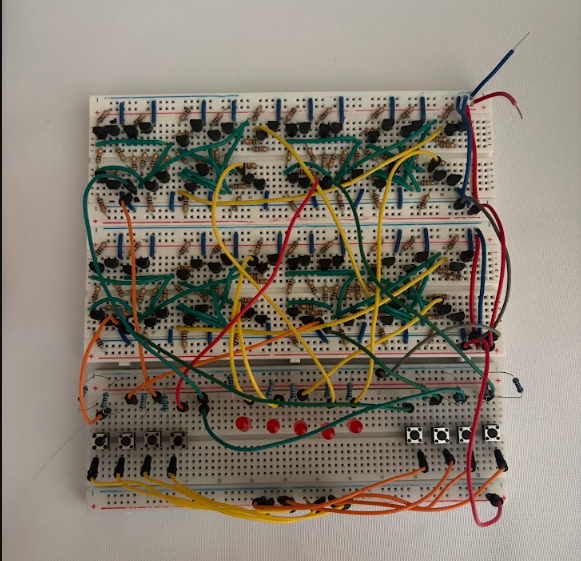
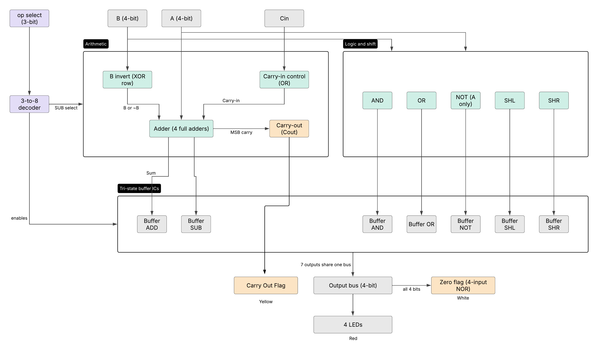

# 4-bit ALU from Discrete Transistors (RTL)
 
A 4-bit arithmetic logic unit built entirely from discrete NPN transistors and resistors using resistor-transistor logic (RTL), wired on breadboards. ICs were only used to implement the tri-state buffers.
 
**Website:** https://hiitsmike1.github.io/michaelcrandall.github.io/
 

 
## Overview
 
The ALU performs seven operations on two 4-bit inputs and places the selected result onto a shared 4-bit output bus. I built it to understand what sits underneath a logic gate: voltage levels, transistor sizing, signal regeneration, and how an output stage can share a bus safely.
 
- **160+ NPN transistors and about 270 resistors** *(confirm the final counts, and add the PNP count if you used totem-pole output stages)*
- **7 operations:** ADD, SUB, AND, OR, NOT, shift left (SHL), shift right (SHR)
- **Tri-state output stage** so all seven operations can drive one 4-bit bus without contention
- **5 V logic levels**, breadboard construction, 2N3904 (NPN) transistors
- **Flags:** Zero (4-input NOR across the output bus) and Carry-out from the most significant adder
- **External carry-in** for future chaining of ALUs
## Operations
 
| Select | Operation | Description |
|--------|-----------|-------------|
| [000]  | NOT  | bitwise NOT of `A`  |
| [001]  | OR | bitwise OR|
| [010]  | AND | bitwise AND|
| [011]  | SHL  | shift `A` left |
| [100]  | SHR | shift `A` right |
| [101]  | ADD | `A + B` |
| [110]  | SUB | `A - B` (two's complement: `A + ~B + 1`)  |
 
## Design
 
### Gate library
 
Everything is built up from a small set of gates, with transistor counts kept as low as I could get them:
 
| Gate | Transistors |
|------|-------------|
| NOT | 1 |
| NAND | 2 |
| NOR | 2 |
| XOR (four NANDs) | 8 |
| Full adder | 23 |
 
Key choices:
- **NAND-based XOR** instead of an AND/OR construction, to avoid voltage drops through the transistors. Used 8 NAND gates to implement XOR.
- **AND and OR built as NAND/NOR followed by a NOT**, which restores a clean logic level at each stage.
- **A separate 10 kΩ base resistor for every transistor.** A seperate resistor allows for a cleaner voltage as a more predictable current comes out of it.
### Arithmetic
 
Four full adders form a ripple-carry adder. Subtraction reuses the same adders by inverting `B` and setting the carry-in to 1 (`A + ~B + 1`). The `B` inversion uses one NAND-based XOR per bit, and the carry-in control uses a small 2-transistor OR gate with the SUB op-code and carry-in.
 
### Output stage and bus sharing
 
Each operation produces its own 4-bit result, and exactly one is allowed onto the output bus at a time:
 
- A **3-to-8 active-low decoder** (27 NPN transistors) turns the 3-bit select into one-cold enable lines.
- Each operation's result passes through a **tri-state buffer** which gives a true high-impedance output when disabled. This is the only use of ICs in the project, as I had a hard time implementing true tri-state logic with NPN transistors.

### Flags
 
- **Zero:** a 4-input NOR on the output bus.
- **Carry-out:** taken from the most significant full adder.

## Testing

I tested this project using buttons for the inputs of A and B, the op-code, and the carry-in. Each bit has its own button, allowing for testing different cases easily without pulling different bits to high or low manually. The output is connected to 4 LEDs with allow for quick verification if theres a bug or not.

I did run into some errors when testing the ALU. Some of the output bits were stuck at HIGH or LOW for some of the operations. Since every operation got its own copy of the input, an error on one operation didn't affect the others. It also allowed me to use a multi-meter to check the voltages without inputing the op-code. 

One specifc error I ran into was near the end of the project. I had tested the operations one by one as I implemented them with a temporary testing board (Image Below). All the operations work independently, but once I hooked up the tri-state buffers and output, one of the bits for B was stuck at HIGH for subtraction. The rest of the subtraction logic worked the same, but no matter the input for B, it read the one bit as HIGH. I ended up using a multimeter to follow the logic of that bit going through the XOR gate for subtraction, and eventually found a resistor running ot the base of a transistor that didn't have a voltage drop across it. This immediately told me that there was no current running through it so there was a contact error ith the breadboard. I replaced the resistor with a new one, and it fixed that bit of B, signaling that one of the resistor leads was bad or too short.



## Photos and Schematics
 

 
## What I Learned
 

 
## Repository Structure
 
```
alu_rtl/
├── images/              # photos
└── README.md
```
 
## Related Projects
 
- [8-bit CPU in Verilog](https://github.com/hiitsmike1/8bit-cpu)
- [ALU in Verilog with Verilator](https://github.com/hiitsmike1/alu_verilator)
## Author
 
Michael Crandall, B.S. Electrical Engineering, University of Maryland (expected December 2028)
[LinkedIn](https://linkedin.com/in/crandall0327) · [Portfolio](https://hiitsmike1.github.io/michaelcrandall.github.io/)